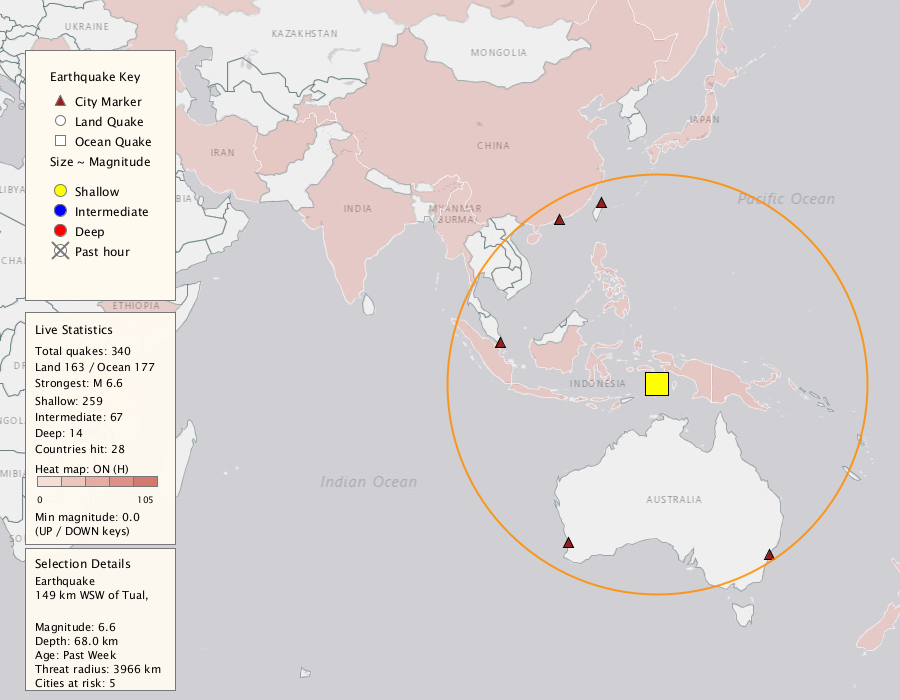
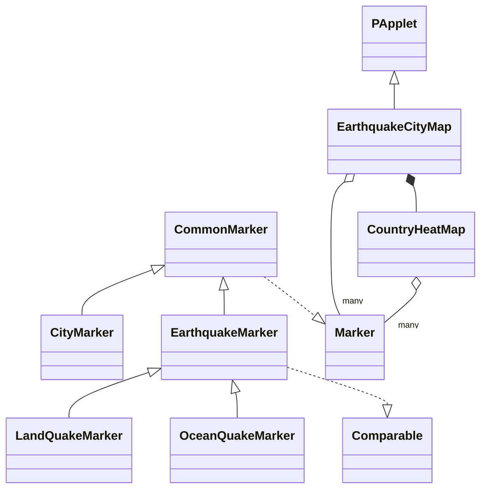
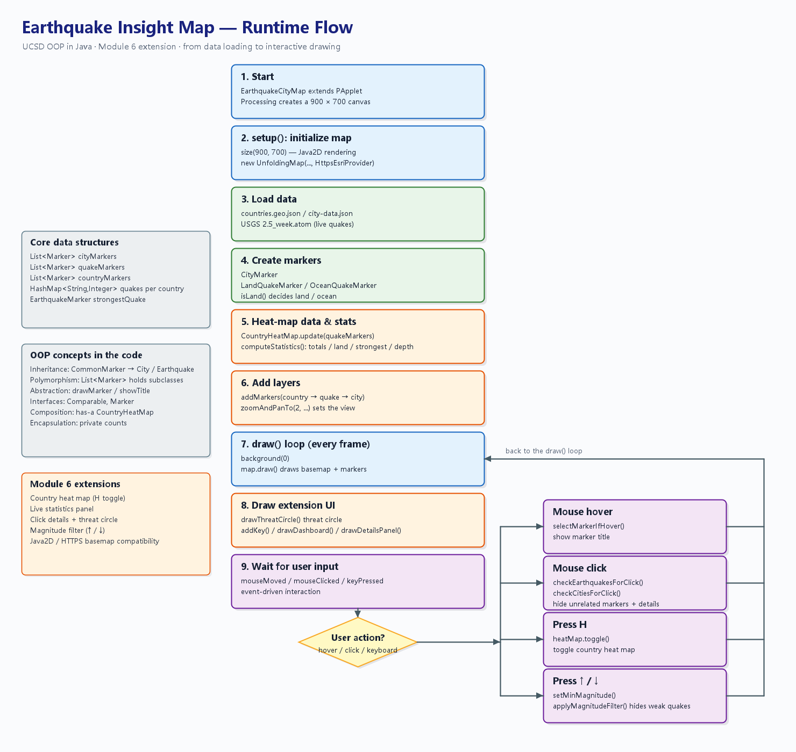
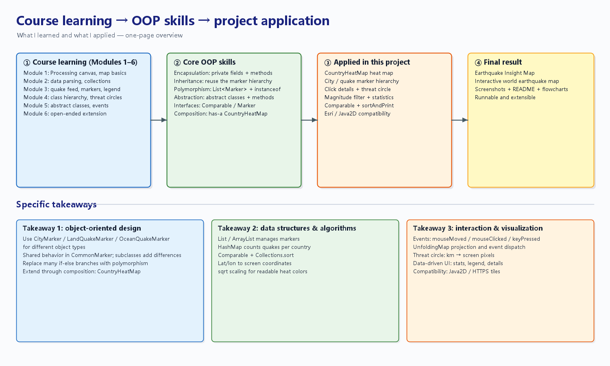

# Earthquake Insight Map

**UCSD OOP in Java · Module 6 Extension Project**

[](README.zh-CN.md) · [中文 README](README.zh-CN.md)

An extension of the UC San Diego **Object Oriented Programming in Java** (Coursera) starter code. The program uses **Processing + Unfolding Maps** to draw a world map, reads live earthquake data from the USGS feed plus GeoJSON city/country data, and uses a hierarchy of marker classes, a composition-based heat map, and event handling to build an interactive earthquake visualisation tool.



> The orange circle in the screenshot is the threat circle of the selected earthquake. The left side shows the legend, live statistics, and the selected earthquake's details.

---

## 1. Overview

This project takes the basic "earthquakes + cities" map from Modules 1–6 and turns it into a small earthquake analysis tool:

- a **country heat map** that shows where land earthquakes are concentrated;
- a **statistics panel** summarising the current feed: totals, land/ocean split, strongest quake, and depth distribution;
- a **drawn threat circle** plus a **details panel** when an earthquake is clicked;
- a **city details panel** with population and the number of earthquakes that can reach the city;
- a **magnitude filter** (`↑` / `↓`) that hides weaker earthquakes;
- the course-required `Comparable` ordering and `sortAndPrint`.

Data sources:

- Earthquakes: USGS `2.5_week.atom` live feed (or the local `2.5_week.atom` when offline)
- Cities: `data/city-data.json`
- Country borders: `data/countries.geo.json`
- Basemap: Esri World Light Gray Canvas (through a custom HTTPS provider)
- Map library: Unfolding Maps 0.9.7 + Processing 2 core

---

## 2. Features

### 2.1 Base features (Modules 1–6)

- World map, city markers, and land/ocean earthquake markers
- Earthquake colour by depth: shallow yellow, intermediate blue, deep red
- Marker size proportional to magnitude
- Hover titles for cities and earthquakes
- Click an earthquake or city to hide unrelated markers and focus on the objects inside its threat circle
- Legend for cities, land/ocean quakes, depth colours, and recent events
- `EarthquakeMarker implements Comparable`, and `sortAndPrint(int)` prints the strongest earthquakes

### 2.2 Extension features

| Feature | Description | How to use |
|---|---|---|
| Country heat map | Colours each country by its number of land earthquakes; uses a square-root scale | Press `H` |
| Live statistics panel | Totals, land/ocean, strongest quake, shallow/intermediate/deep counts, affected countries | Shown automatically |
| Threat circle | Draws an orange circle around the selected earthquake, using `threatCircle()` | Click an earthquake |
| Earthquake details | Magnitude, depth, age, threat radius, number of cities at risk | Click an earthquake |
| City details | City name, country, population, number of threatening earthquakes | Click a city |
| Magnitude filter | Hides earthquakes below a chosen magnitude; coexists with click focus | `↑` / `↓` |
| Clear selection | Restores all markers, then reapplies the magnitude filter | Click again |
| Sorted output | Prints the five strongest earthquakes to the console | On startup |

### 2.3 Controls

| Action | Effect |
|---|---|
| Hover | Show the marker title |
| Click an earthquake | Draw its threat circle, show details, hide unrelated objects |
| Click a city | Show city details and hide earthquakes that cannot reach it |
| Click again | Clear the selection and restore markers |
| `H` | Toggle the country heat map |
| `↑` / `↓` | Raise/lower the minimum magnitude by 0.5 |
| Drag / scroll | Pan / zoom the map (Unfolding default events) |

---

## 3. Getting Started

### 3.1 Command line (Git Bash)

```bash
cd "d:/Year3/OOP/Course1StarterCode-master/UCSDUnfoldingMaps"
javac -encoding UTF-8 -cp "lib/*" -d build $(find src -name "*.java")
java -cp "build;lib/*" processing.core.PApplet module6.EarthquakeCityMap
```

The app downloads the live USGS feed and Esri tiles at startup, so it may take 20–60 seconds to finish loading. The window appears first and the map fills in afterwards.

### 3.2 Eclipse

1. `File` → `Import` → `Existing Projects into Workspace`, choose the `UCSDUnfoldingMaps` folder.
2. Right-click the project → `Properties` → `Java Build Path` → `Libraries`, and change the JRE to **Java 21** (the starter `.classpath` targets JavaSE-1.6).
3. Run `src/module6/EarthquakeCityMap.java`.

### 3.3 Offline mode

Change this line in `EarthquakeCityMap.java`:

```java
private static final boolean offline = false;
```

to `true`. The program then uses the local `data/2.5_week.atom` and `blankLight-1-3.mbtiles` and does not need the network.

### 3.4 Compatibility notes

- **Java2D:** the starter code uses `size(900, 700, OPENGL)`, but the bundled JOGL 2 library crashes on newer Java versions such as Java 21, so the sketch uses the default Java2D renderer.
- **Esri HTTPS:** the original Google basemap now needs an API key. `HttpsEsriProvider` extends `EsriProvider.WorldGrayCanvas` and builds HTTPS tile URLs, avoiding the old image loader's inability to follow HTTP→HTTPS redirects.
- The map fills the whole window and the information panels are drawn on top of its left edge; this also keeps map drawing and mouse coordinates aligned under Java2D.

---

## 4. Project Structure

| File | Purpose |
|---|---|
| `src/module6/EarthquakeCityMap.java` | Main sketch: `setup`/`draw`, data loading, event handling, statistics, details panel, threat circle, magnitude filter |
| `src/module6/CountryHeatMap.java` | **New class:** counts land earthquakes per country, computes colours, toggles the heat layer |
| `src/module6/CommonMarker.java` | Abstract base: shared `draw()` flow and abstract `drawMarker()` / `showTitle()` |
| `src/module6/CityMarker.java` | City triangle marker; provides `getCity` / `getCountry` / `getPopulation` |
| `src/module6/EarthquakeMarker.java` | Abstract earthquake marker: depth colour, threat circle, `Comparable`, `getPlace` / `getAge` |
| `src/module6/LandQuakeMarker.java` | Land earthquake: circular marker with a country property |
| `src/module6/OceanQuakeMarker.java` | Ocean earthquake: square marker |
| `src/module6/HttpsEsriProvider.java` | **New class:** extends `EsriProvider.WorldGrayCanvas` with HTTPS tile URLs |
| `src/parsing/ParseFeed.java` | Starter XML/CSV parsing utilities |
| `data/` | City/country GeoJSON, local earthquake feed, MBTiles offline tiles |
| `lib/` | Processing, Unfolding, JOGL, JSON, and other dependencies |
| `docs/runtime_flowchart_en.png` | English runtime flowchart |
| `docs/learning_flowchart_en.png` | English course-learning → project-application flowchart |
| `docs/runtime_flowchart.png` | Chinese runtime flowchart |
| `docs/learning_flowchart.png` | Chinese learning → application flowchart |

### 4.1 Class diagram



Notes:

- `CommonMarker` extends Unfolding's `SimplePointMarker` and declares the abstract methods `drawMarker()` and `showTitle()`.
- `CityMarker` and `EarthquakeMarker` extend `CommonMarker`; `LandQuakeMarker` and `OceanQuakeMarker` extend `EarthquakeMarker`.
- `EarthquakeMarker` implements `Comparable<EarthquakeMarker>` for magnitude sorting.
- `CountryHeatMap` is **not** a marker subclass; it is a standalone class held by `EarthquakeCityMap` through **composition**, keeping counting and colouring separate from the main sketch.
- `HttpsEsriProvider` extends the third-party `EsriProvider.WorldGrayCanvas` and only overrides tile URL generation.

---

## 5. Flowcharts

### 5.1 Runtime flow



The main flow:

1. `setup()` initialises the canvas and the `UnfoldingMap`.
2. Country, city, and USGS earthquake data are loaded; `isLand()` creates `LandQuakeMarker` or `OceanQuakeMarker` objects.
3. `CountryHeatMap.update()` counts earthquakes per country; `computeStatistics()` fills the dashboard fields.
4. Markers are added in the order country → quake → city, so the heat layer stays underneath the points.
5. `draw()` renders the map, threat circle, and the left-side panels every frame.
6. Mouse and keyboard events are handled by hover, click, `H`, and `↑`/`↓`, then control returns to the `draw()` loop.

### 5.2 Course learning → project application



This one-page diagram connects what the course covered (Modules 1–6), the core OOP skills, the parts of this project where they are used, and the final result.

---

## 6. Course Learning → Project Application

### 6.1 Module-by-module

| Module | What I learned | Where it is used in this project | Code |
|---|---|---|---|
| Module 1 | Processing canvas, `setup`/`draw`, map basics | `size(900,700)`, creating the map and drawing every frame | `EarthquakeCityMap` |
| Module 2 | CSV/XML parsing, `ArrayList`/`HashMap` | Reading city/country GeoJSON, parsing the USGS Atom feed, counting quakes per country | `ParseFeed`, `CountryHeatMap` |
| Module 3 | Earthquake feed, markers, legend, depth colours | Quake markers, size/colour mapping, the left-side key | `EarthquakeMarker`, `addKey()` |
| Module 4 | Class hierarchy, threat circles, click filtering | `CityMarker` / `EarthquakeMarker` / `LandQuakeMarker` / `OceanQuakeMarker`, `threatCircle()`, click focus | marker classes, `checkEarthquakesForClick()` |
| Module 5 | Abstract classes, `Comparable`, event handling | `CommonMarker` abstract methods, `sortAndPrint()`, `mouseMoved`/`mouseClicked`/`keyPressed` | `CommonMarker`, `EarthquakeMarker`, `EarthquakeCityMap` |
| Module 6 | Open-ended extension, code organisation | Heat map, statistics, details panel, drawn threat circle, magnitude filter, HTTPS basemap | `CountryHeatMap`, `HttpsEsriProvider`, `EarthquakeCityMap` |

### 6.2 OOP concepts applied

| Concept | Course idea | In this project |
|---|---|---|
| Encapsulation | Keep data and behaviour in a class; expose only what is needed | `CountryHeatMap` keeps `counts`/`maxCount` private and exposes `update()`, `getCount()`, `toggle()`; `CityMarker` exposes city getters |
| Inheritance | Share common behaviour through a superclass | `CommonMarker` → `CityMarker` / `EarthquakeMarker`; subclasses implement only the drawing differences |
| Polymorphism | Use a superclass/interface reference for different subclasses | `List<Marker>` holds city, land-quake, and ocean-quake markers; `draw()` dispatches to the right subclass |
| Abstraction | Define a template with abstract methods | `CommonMarker.draw()` defines the flow; `EarthquakeMarker` centralises depth colours, threat circles, and `Comparable` |
| Interfaces | Program against a contract | `EarthquakeMarker implements Comparable`; `CountryHeatMap` only depends on the `Marker` interface |
| Composition | Prefer "has-a" for separable responsibilities | `EarthquakeCityMap` has a `CountryHeatMap` and marker lists instead of putting every detail in one class |
| Collections | Use the right data structure | `ArrayList` for markers, `HashMap<String,Integer>` for country counts |
| Sorting | Natural ordering with `Comparable` | `sortAndPrint(5)` prints the strongest five earthquakes |
| Event-driven design | React to mouse/keyboard events | Hover titles, click focus/details, `H` toggle, `↑`/`↓` filter |
| Data visualisation | Map data to colour/size/position | Country colours, marker sizes, `getScreenPosition()`, threat circle km → pixels |
| File/network I/O | Read local files and URLs | GeoJSON/Atom parsing, live USGS feed, Esri tile requests |

### 6.3 Key takeaways

1. **Polymorphism instead of branches:** cities, land earthquakes, and ocean earthquakes are marker subclasses, so `draw()` dispatches at runtime rather than using a long `if/else` chain.
2. **A stable abstract skeleton:** `CommonMarker.draw()` handles hidden/selected state and calls the subclass drawing methods; subclasses only provide their shape and title.
3. **Composition over a god class:** `CountryHeatMap` owns counting and colouring; `EarthquakeCityMap` only coordinates it. Changing the heat-map logic does not require touching the marker hierarchy.
4. **Data structures shape the implementation:** `HashMap` for per-country counts, `List` for markers, and `Comparable` for sorting keep the code much simpler than nested loops.
5. **Interaction and coordinate conversion:** deciding which marker the mouse is over, converting kilometres to screen pixels, and drawing the threat circle are the key steps from raw data to an interactive visualisation.

---

## 7. Extension Implementation Details

### 7.1 `CountryHeatMap`

- `update(List<Marker> quakeMarkers)` walks the earthquake markers, casts each to `EarthquakeMarker`, and uses `isOnLand()` plus the `"country"` property to increment a `HashMap<String,Integer>`.
- `updateCountryColors()` calls `setColor()`, `setStrokeColor()`, and `setStrokeWeight()` on every country marker.
- Colour intensity is `sqrt(count) / sqrt(maxCount)`, so countries with a few quakes remain visible even when one country (usually the USA) has far more.
- Countries with no earthquakes use an almost transparent fill with alpha 1. (Processing 2 treats alpha 0 as fully opaque; this was a useful pitfall to discover.)
- `setVisible()` / `toggle()` implement the `H` key switch.

### 7.2 Statistics panel

- `computeStatistics()` makes one pass over `quakeMarkers` to fill:
  - land/ocean counts (`isOnLand()`)
  - shallow/intermediate/deep counts (`THRESHOLD_INTERMEDIATE`, `THRESHOLD_DEEP`)
  - strongest quake (by `getMagnitude()`)
  - affected-country count (from `CountryHeatMap.getAffectedCountryCount()`)
- `drawDashboard()` renders those fields, the heat-map legend, and the current magnitude threshold.

### 7.3 Click details and threat circle

- `drawDetailsPanel()` uses `instanceof` to distinguish `EarthquakeMarker` from `CityMarker`.
- Earthquake details: `getPlace()` (the location part of the title), `getMagnitude()`, `getDepth()`, `getAge()`, `threatCircle()`, and `countCitiesAtRisk()`.
- City details: `getCity()`, `getCountry()`, and `getPopulation()` (the three getters were changed from private to public), plus `countQuakesThreatening()`.
- `drawThreatCircle()`:
  - gets the epicentre's screen position;
  - gets the screen position of a point one threat radius north of the epicentre;
  - uses the vertical pixel difference as the ellipse radius;
  - draws the circle with `noFill()` and an orange stroke.

### 7.4 Magnitude filter

- `keyPressed()` handles `UP` / `DOWN` and updates `minMagnitude`.
- `setMinMagnitude()` clears the current selection and calls `unhideMarkers()`.
- `unhideMarkers()` restores all markers and then calls `applyMagnitudeFilter()`, so the filter and click focus can coexist without overwriting each other's hidden state.
- `applyMagnitudeFilter()` calls `setHidden(true)` on every quake below the threshold.
- `selectMarkerIfHover()` skips hidden markers, so a filtered-out quake cannot show a tooltip.

### 7.5 Base requirements

- `EarthquakeMarker implements Comparable<EarthquakeMarker>`; `compareTo()` compares magnitudes.
- `EarthquakeCityMap.sortAndPrint(int)` copies the quake markers into a `List<EarthquakeMarker>`, sorts with `Collections.sort()`, and prints from strongest to weakest; `setup()` calls `sortAndPrint(5)`.
- `EarthquakeMarker.getPlace()` and `getAge()` feed the details panel.
- `CityMarker`'s city/country/population getters were made public.

### 7.6 Compatibility changes

- `size(900, 700)` uses Java2D instead of OPENGL; the bundled JOGL 2 fails on Java 21.
- `HttpsEsriProvider` extends `EsriProvider.WorldGrayCanvas` and overrides `getTileUrls()` with HTTPS URLs.
- The map uses the full window `(0, 0, 900, 700)` and the panels overlay its left edge, keeping Java2D drawing and mouse coordinates aligned.

---

## 8. Screenshots

| File | Description |
|---|---|
| `peer_review_screenshot.png` | Main screenshot: selected M6.6 earthquake, threat circle, heat map, statistics/details |
| `earthquake_extension.png` | Global overview: country heat map + statistics panel |
| `earthquake_filter.png` | Magnitude filter at minimum magnitude 4.5 |
| `docs/runtime_flowchart_en.png` | English runtime flowchart |
| `docs/learning_flowchart_en.png` | English course-learning → application flowchart |
| `docs/runtime_flowchart.png` | Chinese runtime flowchart |
| `docs/learning_flowchart.png` | Chinese learning → application flowchart |

> The numbers in the screenshots (total earthquakes, strongest magnitude, etc.) come from the live USGS feed at capture time and will change on later runs.

The course-submission documents `peer_review_submission.md` and `coursera_form_answers.md` are kept locally and are not included in this repository.

---

## 9. Known Limitations and Future Work

- **Network required:** the live feed and Esri tiles need internet access. Offline mode uses the bundled 2015 feed and MBTiles.
- **Statistics are computed at startup:** if the feed changes while the program is running, the dashboard does not refresh automatically. A timer or manual refresh could be added.
- **Land quakes only in the heat map:** ocean earthquakes have no country assignment and are not counted per country.
- **Low-zoom map boundaries:** Unfolding may not draw some Pacific tiles when the viewport crosses the 180° meridian; the demo screenshot keeps the view west of 95°E.
- **Java2D performance:** the old Processing/JOGL stack does not work with Java 21, and Java2D is slower than OpenGL for large data sets. The current feed is small enough.
- **Filter and click focus both use `hidden`:** `unhideMarkers()` reapplies the filter to keep them consistent. A larger project could introduce a separate visibility model.
- **Possible extensions:** country labels, search, time-range filters, a sorted side list, or making the heat layer clickable.

---

## 10. References

- UC San Diego · Coursera: *Object Oriented Programming in Java* starter code
- [Unfolding Maps](http://unfoldingmaps.org/)
- [Processing](https://processing.org/)
- [USGS Earthquake Hazards Program](https://earthquake.usgs.gov/earthquakes/feed/)
- Esri World Light Gray Canvas basemap
- Course Modules 1–6 examples and slides

---

## 11. Quick Recap

- The course teaches **object-oriented thinking**: abstraction, inheritance, polymorphism, interfaces, composition, collections, and event-driven design.
- This project applies those ideas to a working map application: **marker class hierarchy + composition-based heat map + event-driven interaction + data visualisation**.
- Flowcharts: `docs/runtime_flowchart_en.png` and `docs/learning_flowchart_en.png` (Chinese versions in `docs/runtime_flowchart.png` and `docs/learning_flowchart.png`).
- Main screenshot: `peer_review_screenshot.png`.
