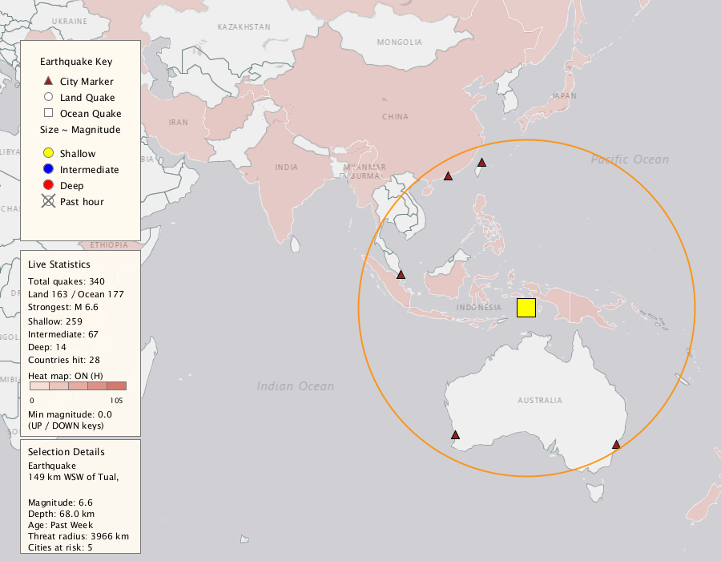
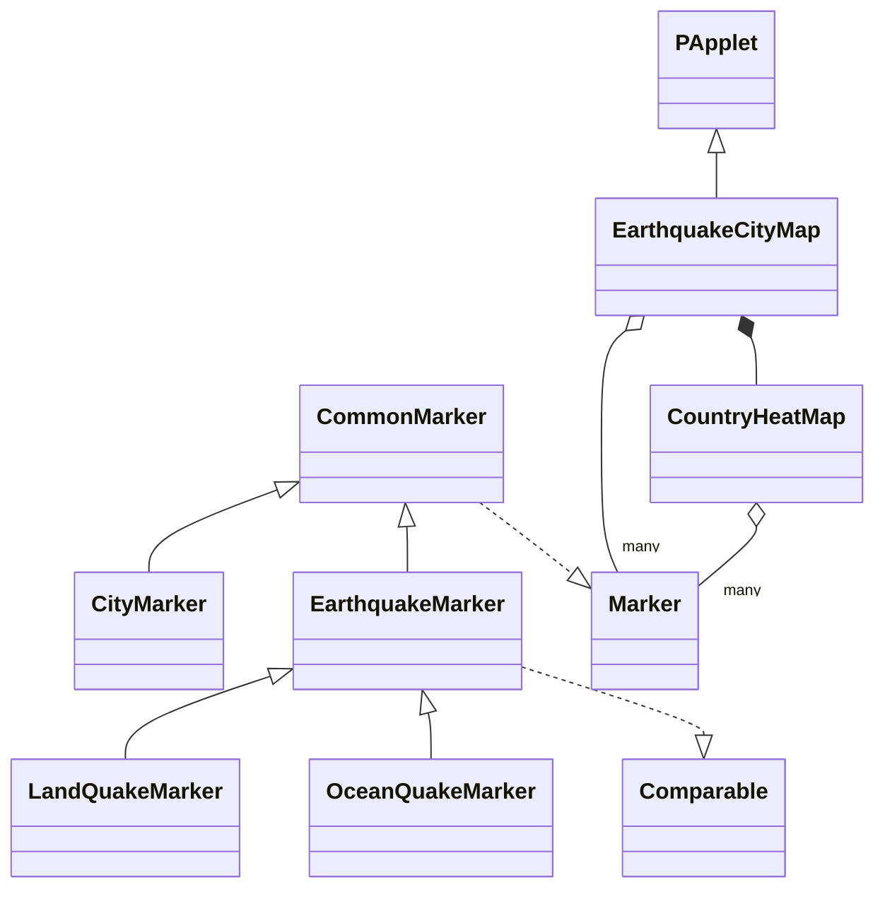
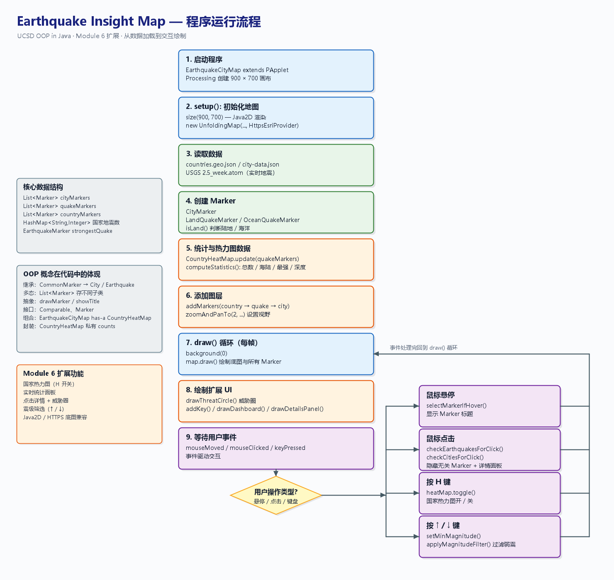
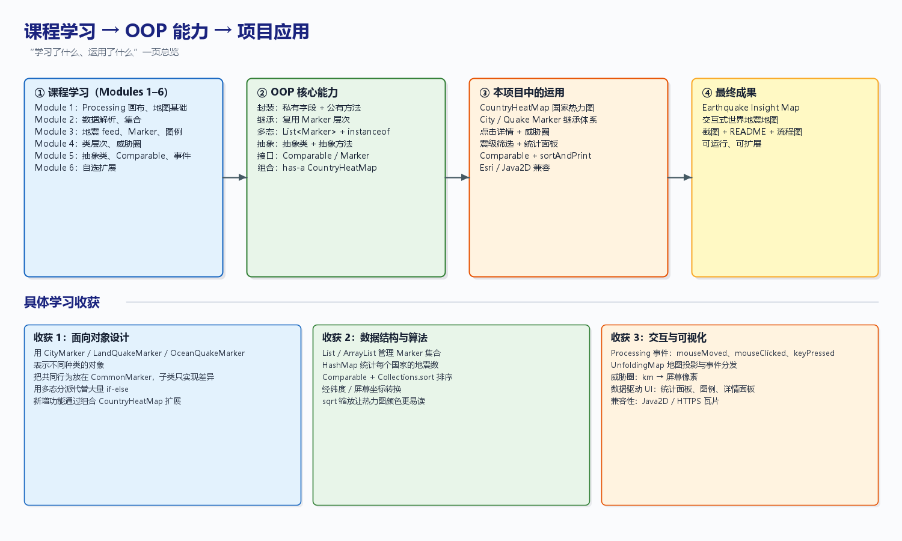

[](README.md)

# Earthquake Insight Map

**UCSD OOP in Java · Module 6 扩展项目**

基于 Coursera《Object Oriented Programming in Java》（UC San Diego）课程 starter code 的地震地图扩展项目。程序使用 **Processing + Unfolding Maps** 绘制世界地图，从 USGS 实时地震 feed 和 GeoJSON 城市/国家数据中读取信息，并用多个 Marker 子类、组合类和事件处理实现交互式地震可视化。



> 截图中的橙色圆圈是选中地震的威胁圈；左侧为图例、实时统计和选中地震的详情面板。

---

## 1. 项目简介

这个项目在课程 Modules 1–6 的基础上，把原来的“地震点 + 城市点”地图扩展成一个小型地震分析工具：

- 用**国家热力图**显示每个国家陆地地震的多少；
- 用**统计面板**汇总当前 feed 的总数、海陆分布、最强地震和深度分布；
- 点击地震时**绘制威胁圈**，并显示震级、深度、时间、威胁半径和受影响城市数；
- 点击城市时显示人口和威胁该城市的地震数量；
- 用 `↑` / `↓` 按震级过滤，只保留较强地震；
- 补全课程要求的 `Comparable` 排序和 `sortAndPrint`。

数据来源：

- 地震：USGS `2.5_week.atom` 实时 feed（也可切换为本地 `2.5_week.atom`）
- 城市：`data/city-data.json`
- 国家边界：`data/countries.geo.json`
- 底图：Esri World Light Gray Canvas（通过自定义 HTTPS provider）
- 地图库：Unfolding Maps 0.9.7 + Processing 2 core

---

## 2. 功能

### 2.1 基础功能（Modules 1–6）

- 世界地图、城市 Marker、陆地/海洋地震 Marker
- 地震按深度着色：浅源黄色、中源蓝色、深源红色
- Marker 大小与震级相关
- 鼠标悬停显示城市/地震标题
- 点击地震或城市后隐藏无关 Marker，聚焦威胁圈内的对象
- 图例（城市、陆地/海洋地震、深度、过去一小时）
- `EarthquakeMarker implements Comparable`，`sortAndPrint(int)` 按震级排序输出最强地震

### 2.2 扩展功能

| 功能 | 说明 | 操作 |
|---|---|---|
| 国家热力图 | 按每个国家陆地地震数量着色；颜色从浅到深，使用平方根缩放 | `H` 开关 |
| 实时统计面板 | 总数、陆地/海洋、最强地震、浅/中/深数量、受影响国家数 | 自动显示 |
| 威胁圈绘制 | 选中地震时画出橙色圆圈，半径来自 `threatCircle()` | 点击地震 |
| 地震详情面板 | 震级、深度、时间、威胁半径、受影响城市数 | 点击地震 |
| 城市详情面板 | 城市名、国家、人口、威胁该城市的地震数 | 点击城市 |
| 震级筛选 | 隐藏低于阈值的弱震，可与点击聚焦共存 | `↑` / `↓` |
| 取消选择 | 再次点击空白/已选对象，恢复所有 Marker | 再次点击 |
| 排序输出 | 控制台打印最强 5 个地震 | 启动时自动 |

### 2.3 操作汇总

| 操作 | 效果 |
|---|---|
| 鼠标悬停 | 显示 Marker 标题 |
| 点击地震 | 绘制威胁圈 + 显示地震详情 + 隐藏无关对象 |
| 点击城市 | 显示城市详情 + 隐藏不威胁该城市的地震 |
| 再次点击 | 清除选择、恢复 Marker（同时重新应用震级筛选） |
| `H` | 国家热力图开/关 |
| `↑` / `↓` | 最低震级 +0.5 / -0.5 |
| 拖动/滚轮 | 平移/缩放地图（Unfolding 默认事件） |

---

## 3. 运行方法

### 3.1 命令行（Git Bash）

```bash
cd "d:/Year3/OOP/Course1StarterCode-master/UCSDUnfoldingMaps"
javac -encoding UTF-8 -cp "lib/*" -d build $(find src -name "*.java")
java -cp "build;lib/*" processing.core.PApplet module6.EarthquakeCityMap
```

启动时会联网下载 USGS 实时数据和 Esri 瓦片，可能需要 20–60 秒；窗口会先出现，地图随后加载完成。

### 3.2 Eclipse

1. `File` → `Import` → `Existing Projects into Workspace`，选择 `UCSDUnfoldingMaps` 文件夹。
2. 项目右键 → `Properties` → `Java Build Path` → `Libraries`，把 JRE 改成 **Java 21**（原 `.classpath` 是 JavaSE-1.6）。
3. 运行 `src/module6/EarthquakeCityMap.java`。

### 3.3 离线模式

把 `EarthquakeCityMap.java` 中的：

```java
private static final boolean offline = false;
```

改成 `true`，程序会使用本地 `data/2.5_week.atom` 和 `blankLight-1-3.mbtiles`，不依赖网络。

### 3.4 兼容性说明

- **Java2D**：原 starter code 使用 `size(900, 700, OPENGL)`，但项目自带的 JOGL 2 在新版 Java（如 Java 21）上会崩溃，所以改用默认 Java2D 渲染器。
- **Esri HTTPS**：原 Google 底图服务现在需要 API key；`HttpsEsriProvider` 继承 `EsriProvider.WorldGrayCanvas`，把瓦片 URL 改为 HTTPS，避免旧图片加载器不跟随 HTTP→HTTPS 重定向的问题。
- 地图改为全窗口显示，左侧面板叠加在地图上，避免 Java2D 下地图位置与鼠标坐标不一致。

---

## 4. 代码结构

| 文件 | 作用 |
|---|---|
| `src/module6/EarthquakeCityMap.java` | 主 Sketch：`setup`/`draw`、数据加载、事件处理、统计面板、详情面板、威胁圈、震级筛选 |
| `src/module6/CountryHeatMap.java` | **新增类**：统计每个国家的陆地地震数，计算颜色，控制热力图显示/隐藏 |
| `src/module6/CommonMarker.java` | 抽象基类：统一 `draw()` 流程，声明 `drawMarker()` / `showTitle()` |
| `src/module6/CityMarker.java` | 城市三角形 Marker；提供 `getCity/getCountry/getPopulation` |
| `src/module6/EarthquakeMarker.java` | 抽象地震 Marker：深度颜色、威胁圈、`Comparable`、`getPlace/getAge` |
| `src/module6/LandQuakeMarker.java` | 陆地地震：圆形 Marker，带国家属性 |
| `src/module6/OceanQuakeMarker.java` | 海洋地震：方形 Marker |
| `src/module6/HttpsEsriProvider.java` | **新增类**：继承 `EsriProvider.WorldGrayCanvas`，生成 HTTPS 瓦片 URL |
| `src/parsing/ParseFeed.java` | 课程 starter 的 XML/CSV 解析工具 |
| `data/` | 城市、国家 GeoJSON，本地地震 feed，MBTiles 离线瓦片 |
| `lib/` | Processing、Unfolding、JOGL、JSON 等依赖 |
| `docs/runtime_flowchart.png` | 程序运行流程图 |
| `docs/learning_flowchart.png` | 课程学习 → 项目应用流程图 |

### 4.1 类图



说明：

- `CommonMarker` 继承 Unfolding 的 `SimplePointMarker`，并声明抽象方法 `drawMarker()`、`showTitle()`。
- `CityMarker` 和 `EarthquakeMarker` 继承 `CommonMarker`；`LandQuakeMarker`、`OceanQuakeMarker` 再继承 `EarthquakeMarker`。
- `EarthquakeMarker` 实现 `Comparable<EarthquakeMarker>`，用于按震级排序。
- `CountryHeatMap` **不是** Marker 子类，而是一个独立类；`EarthquakeCityMap` 通过**组合**持有一个 `CountryHeatMap`，符合“数据统计和颜色计算”单独封装的思路。
- `HttpsEsriProvider` 继承第三方类 `EsriProvider.WorldGrayCanvas`，只覆盖瓦片 URL 生成。

---

## 5. 流程图

### 5.1 程序运行流程



流程说明：

1. `setup()` 初始化画布和 `UnfoldingMap`。
2. 读取国家、城市和 USGS 地震数据，按 `isLand()` 创建 `LandQuakeMarker` 或 `OceanQuakeMarker`。
3. `CountryHeatMap.update()` 统计国家地震数，`computeStatistics()` 计算统计字段。
4. 按 country → quake → city 的顺序添加 Marker，让热力图位于最底层。
5. `draw()` 每帧绘制地图、威胁圈和左侧面板。
6. 鼠标/键盘事件分别交给悬停、点击、`H`、`↑`/`↓` 处理，处理完回到 `draw()` 循环。

### 5.2 课程学习 → 项目应用



这张图把课程 Modules 1–6 学到的内容、OOP 核心能力、项目中的具体应用和最终成果放在同一页，方便回顾“学了什么、用了什么”。

---

## 6. 课程学习 → 项目应用总结

### 6.1 按模块回顾

| 课程模块 | 学到的内容 | 在本项目中的运用 | 代码位置 |
|---|---|---|---|
| Module 1 | Processing 画布、`setup`/`draw`、地图基础 | `size(900,700)`、`setup()` 创建地图、`draw()` 每帧绘制 | `EarthquakeCityMap` |
| Module 2 | CSV/XML 解析、`ArrayList`/`HashMap` | 读取城市/国家 GeoJSON、解析 USGS Atom feed、统计国家地震数 | `ParseFeed`、`CountryHeatMap` |
| Module 3 | 地震 feed、Marker、图例、深度颜色 | 创建地震 Marker、大小/颜色映射、左侧图例 | `EarthquakeMarker`、`addKey()` |
| Module 4 | 类层次、威胁圈、点击过滤 | `CityMarker` / `EarthquakeMarker` / `LandQuakeMarker` / `OceanQuakeMarker`，`threatCircle()`，点击聚焦 | 各 Marker 类、`checkEarthquakesForClick()` |
| Module 5 | 抽象类、`Comparable`、事件处理 | `CommonMarker` 抽象方法、`sortAndPrint()`、`mouseMoved`/`mouseClicked`/`keyPressed` | `CommonMarker`、`EarthquakeMarker`、`EarthquakeCityMap` |
| Module 6 | 自选扩展、代码组织 | 国家热力图、统计面板、详情面板、威胁圈绘制、震级筛选、HTTPS 底图 | `CountryHeatMap`、`HttpsEsriProvider`、`EarthquakeCityMap` |

### 6.2 学到的 OOP 概念与运用

| 概念 | 课程中的体现 | 本项目中的运用 |
|---|---|---|
| 封装 | 把数据和操作放在类中，提供 getter/setter | `CountryHeatMap` 私有 `counts`/`maxCount`，对外只暴露 `update()`、`getCount()`、`toggle()`；`CityMarker` 提供公开 getter |
| 继承 | `CommonMarker` → `CityMarker`/`EarthquakeMarker` | 子类复用父类的绘制流程，只实现 `drawMarker()`/`showTitle()`/`drawEarthquake()` |
| 多态 | 用父类/接口引用子类对象 | `List<Marker>` 同时存放城市、陆地地震、海洋地震；运行时调用各自的 `draw()` |
| 抽象类 | 抽象类定义模板，子类实现差异 | `CommonMarker` 统一 `draw()`；`EarthquakeMarker` 统一深度颜色、威胁圈、`Comparable` |
| 接口 | `Comparable`、Unfolding 的 `Marker` | `EarthquakeMarker implements Comparable`；`CountryHeatMap` 只依赖 `Marker` 接口，不依赖具体子类 |
| 组合 | “has-a”关系 | `EarthquakeCityMap` 持有 `CountryHeatMap`、`List<Marker>`；比把所有逻辑塞进主类更清晰 |
| 集合 | `ArrayList`、`HashMap` | `cityMarkers`/`quakeMarkers`/`countryMarkers`；`HashMap<String,Integer>` 统计国家地震数 |
| 排序 | `Comparable` + `Collections.sort` | `sortAndPrint(5)` 从最强到最弱打印 |
| 事件驱动 | `mouseMoved`/`mouseClicked`/`keyPressed` | 悬停标题、点击聚焦/详情、`H` 热力图、`↑`/`↓` 筛选 |
| 数据可视化 | 经纬度 → 屏幕坐标、颜色/大小映射 | `map.getScreenPosition()`；威胁圈 km → 像素；热力图 alpha 用 `sqrt(count/max)` |
| 文件/网络 I/O | `loadStrings`/`loadXML`/URL | 读取 GeoJSON/Atom feed；Esri 瓦片和 USGS 实时数据 |

### 6.3 最大的收获

1. **用多态代替分支**：城市、陆地地震、海洋地震不是靠大量 `if/else` 区分，而是各自成为 `Marker` 子类，在 `draw()` 时由 Java 动态分派。
2. **抽象出稳定的骨架**：`CommonMarker.draw()` 负责“是否隐藏、是否选中、调用哪个绘制方法”，子类只关心自己的形状和标题，减少重复代码。
3. **组合优于把所有东西塞进主类**：`CountryHeatMap` 单独负责统计和配色，`EarthquakeCityMap` 只负责组织和调用；以后要换配色或增加新图层更容易。
4. **数据结构决定实现方式**：用 `HashMap` 统计国家、用 `List` 管理 Marker、用 `Comparable` 排序，比手写多重循环更清晰。
5. **交互与坐标转换**：从鼠标位置判断 Marker、把公里转换成屏幕像素、把威胁圈画在地图上，是“数据 → 可视化”的关键一步。

---

## 7. 扩展实现细节

### 7.1 `CountryHeatMap`

- `update(List<Marker> quakeMarkers)`：遍历地震 Marker，转成 `EarthquakeMarker`，用 `isOnLand()` 和 `"country"` 属性累加 `HashMap<String,Integer>`。
- `updateCountryColors()`：对每个国家 Marker 调用 `setColor()`、`setStrokeColor()`、`setStrokeWeight()`。
- 颜色强度：`sqrt(count) / sqrt(maxCount)`，避免美国等地震特别多的国家把其他国家“压扁”。
- 没有地震的国家使用 alpha=1 的近透明填充（Processing 2 会把 alpha=0 当成不透明，这是踩过的坑）。
- `setVisible()/toggle()`：`H` 键开关热力图。

### 7.2 统计面板

- `computeStatistics()` 遍历一次 `quakeMarkers`：
  - 陆地/海洋数量（`isOnLand()`）
  - 浅源/中源/深源（`THRESHOLD_INTERMEDIATE`、`THRESHOLD_DEEP`）
  - 最强地震（比较 `getMagnitude()`）
  - 受影响国家数（来自 `CountryHeatMap.getAffectedCountryCount()`）
- `drawDashboard()` 负责画面板、热力图图例、当前震级阈值。

### 7.3 点击详情与威胁圈

- `drawDetailsPanel()` 用 `instanceof` 区分 `EarthquakeMarker` 和 `CityMarker`。
- 地震详情：`getPlace()`（从标题中取地点）、`getMagnitude()`、`getDepth()`、`getAge()`、`threatCircle()`、`countCitiesAtRisk()`。
- 城市详情：`getCity()`、`getCountry()`、`getPopulation()`（这三个 getter 从 private 改为 public）、`countQuakesThreatening()`。
- `drawThreatCircle()`：
  - 取震中屏幕坐标；
  - 取“震中向北一个威胁半径”的点的屏幕坐标；
  - 用纵向像素差作为椭圆半径；
  - `noFill()` + 橙色 `ellipse()`。

### 7.4 震级筛选

- `keyPressed()`：`UP`/`DOWN` 调整 `minMagnitude`。
- `setMinMagnitude()`：清除当前选择，调用 `unhideMarkers()`。
- `unhideMarkers()`：先恢复所有 Marker，再调用 `applyMagnitudeFilter()`。
- `applyMagnitudeFilter()`：低于阈值的 quake `setHidden(true)`。
- `selectMarkerIfHover()`：跳过隐藏 Marker，避免被过滤的地震还能弹出标题。
- 这样“点击聚焦”和“震级筛选”可以同时工作，不会互相覆盖隐藏状态。

### 7.5 基础要求补全

- `EarthquakeMarker implements Comparable<EarthquakeMarker>`，`compareTo()` 比较震级。
- `EarthquakeCityMap.sortAndPrint(int)`：复制到 `List<EarthquakeMarker>`，`Collections.sort()`，从后往前打印最强 N 个；在 `setup()` 中调用 `sortAndPrint(5)`。
- `EarthquakeMarker.getPlace()` / `getAge()`：供详情面板使用。
- `CityMarker` 的 getter 改为 public。

### 7.6 兼容性改动

- `size(900, 700)` 使用 Java2D，不用 OPENGL；否则 Java 21 下 JOGL 2 报错。
- `HttpsEsriProvider`：继承 `EsriProvider.WorldGrayCanvas`，覆盖 `getTileUrls()`，用 HTTPS 瓦片。
- 地图改为 `(0, 0, 900, 700)` 全窗口；左侧面板叠加，避免 Java2D 下地图绘制位置与鼠标坐标不一致。

---

## 8. 截图与提交文件

| 文件 | 用途 |
|---|---|
| `peer_review_screenshot.png` | 主要截图：选中 M6.6 地震、威胁圈、热力图、统计/详情面板 |
| `earthquake_extension.png` | 全球总览：国家热力图 + 统计面板 |
| `earthquake_filter.png` | 震级筛选效果（最低震级 4.5） |
| `docs/runtime_flowchart.png` | 程序运行流程图（中文） |
| `docs/learning_flowchart.png` | 课程学习 → 项目应用流程图（中文） |
| `docs/runtime_flowchart_en.png` | 程序运行流程图（英文） |
| `docs/learning_flowchart_en.png` | 课程学习 → 项目应用流程图（英文） |

> 课程提交用的 `peer_review_submission.md` / `coursera_form_answers.md` 仅保存在本地，不包含在 GitHub 仓库中。

> 截图中的数字（总地震数、最强震级等）来自截图时的实时 USGS feed，之后运行时会随数据更新。

---

## 9. 已知限制与可改进方向

- **需要联网**：实时 feed 和 Esri 瓦片都需要网络；离线模式使用 2015 年的本地 feed 和 MBTiles。
- **统计是启动时计算的**：如果 feed 在运行期间更新，统计面板不会自动刷新；可以加定时器或手动刷新。
- **热力图只统计陆地地震**：海洋地震没有国家归属，不进入国家计数。
- **低缩放下的地图边界**：Unfolding 在跨 180° 经线时可能不绘制部分太平洋瓦片；演示截图把视野放在 95°E 以西。
- **Java2D 性能**：旧版 Processing/JOGL 与 Java 21 不兼容，Java2D 在大数据量下不如 OPENGL；本项目数据量小，足够。
- **筛选和点击聚焦都用 `hidden`**：目前通过 `unhideMarkers()` 重新应用筛选来协调；更大规模的项目可以引入独立的可见性状态。
- **可扩展**：可以加国家标签、搜索、时间范围筛选、按震级/深度排序的侧边列表，或将热力图改成可点击图层。

---

## 10. 参考

- UC San Diego · Coursera: *Object Oriented Programming in Java* 课程 starter code
- [Unfolding Maps](http://unfoldingmaps.org/)
- [Processing](https://processing.org/)
- [USGS Earthquake Hazards Program](https://earthquake.usgs.gov/earthquakes/feed/)
- Esri World Light Gray Canvas basemap
- 课程 Modules 1–6 的示例代码与课件

---

## 11. 快速回顾

- 课程教的是 **OOP 思维**：抽象、继承、多态、接口、组合、集合、事件驱动。
- 本项目把这些概念落到一个可运行的地图应用里：**Marker 类层次 + 组合式热力图 + 事件驱动交互 + 数据可视化**。
- 流程图见 `docs/runtime_flowchart.png` 和 `docs/learning_flowchart.png`。
- 截图见 `peer_review_screenshot.png`。
